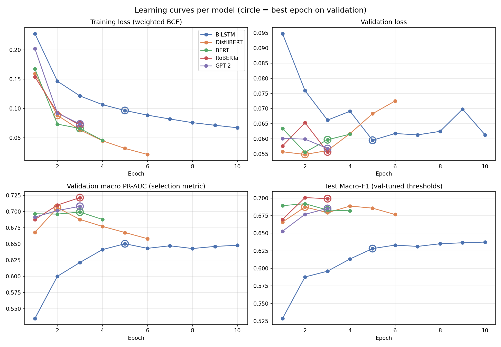
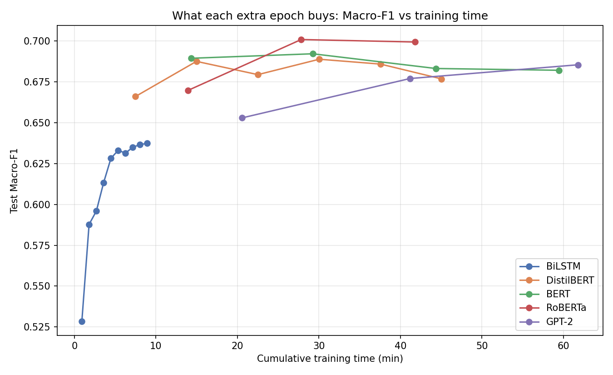
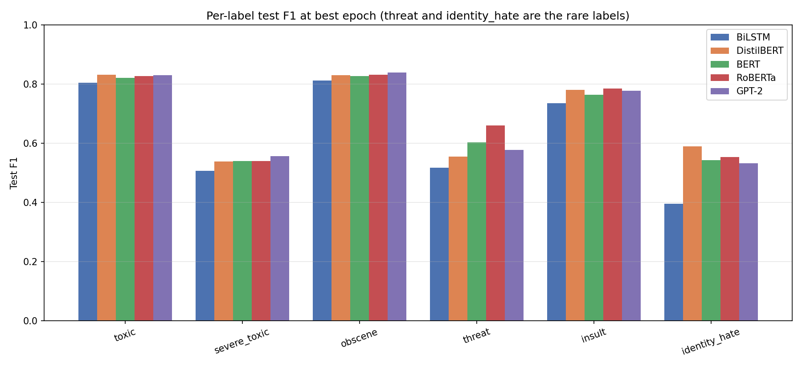
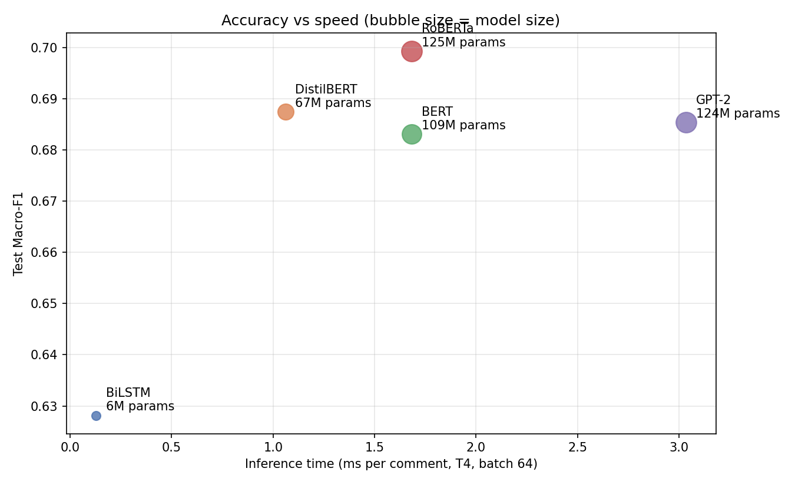

# 🛡️ Toxic Comment Detection — BiLSTM vs DistilBERT vs BERT vs RoBERTa vs GPT-2


A multi-epoch comparative case study of **sequence learning vs transformer models** for multi-label toxic comment classification on the **Jigsaw Toxic Comment Classification** dataset.

> **MAT339 · Transformer Models & Sequence Learning** · MSc Data Science, SASTRA Deemed to be University
> Author: **Priyadharshini Sivasankar** · [Portfolio](https://priyadharshini2002-source.github.io/priyadharshini-data-science-portfolio/)

---

## 📌 Problem
Online platforms need to flag abusive comments automatically. Each comment can carry any of **six labels**: `toxic`, `severe_toxic`, `obscene`, `threat`, `insult` and `identity_hate`. The rare labels (threat, identity_hate) are the hardest to detect. This project asks:

1. How much do contextual **transformers** improve over a recurrent **BiLSTM**?
2. Do **encoder** transformers (BERT, RoBERTa, DistilBERT) beat a **decoder** transformer (GPT-2) at classification?
3. What does each model cost in training time, inference speed and size?

## 🏆 Results (test set, best epoch)

| Model | Type | Macro-F1 | Micro-F1 | ROC-AUC | PR-AUC | Inference (ms/comment) | Size (MB) | Train time (min) |
|---|---|---|---|---|---|---|---|---|
| **RoBERTa** | Encoder transformer | **0.699** | **0.792** | 0.989 | **0.740** | 1.68 | 476 | 41.8 |
| DistilBERT | Distilled encoder | 0.687 | 0.789 | 0.989 | 0.735 | 1.06 | 255 | 45.0 |
| GPT-2 | Decoder transformer | 0.685 | 0.790 | 0.989 | 0.738 | 3.04 | 475 | 61.8 |
| BERT-base | Encoder transformer | 0.683 | 0.779 | 0.987 | 0.715 | 1.68 | 418 | 59.4 |
| BiLSTM | Recurrent sequence model | 0.628 | 0.755 | 0.984 | 0.656 | **0.13** | **24** | **8.9** |

### Key findings
- 🥇 **RoBERTa** is the most accurate model overall, with the best macro-F1 and PR-AUC.
- ⚖️ **DistilBERT** gives the best accuracy for its cost. It comes within about 0.01 of RoBERTa at roughly half the size and with the fastest transformer inference.
- 🔄 **GPT-2** (decoder-only) is competitive on accuracy but about 1.8× slower at inference and the slowest to train.
- 📉 **BiLSTM** trails by about 0.07 macro-F1, mostly on rare labels (identity_hate F1 0.40 vs 0.53–0.59 for transformers). It is still around 8× faster and 10× smaller than DistilBERT.
- 🧪 Choosing the best epoch on validation matters: DistilBERT peaked at epoch 2 and lost about 0.011 macro-F1 by its last epoch as it began to overfit.

## 📊 Screenshots

### Learning curves (train / validation loss and score per epoch)


### Macro-F1 vs training time


### Per-label F1


### Accuracy vs inference speed


## ⚙️ Method
- **Data:** Jigsaw Toxic Comment Classification (`train.csv`, ~159K comments). It is split 80 / 10 / 10 into train, validation and test sets, stratified on "any toxic", with a fixed seed so every model sees the same splits.
- **Models:** BiLSTM (trained from scratch in PyTorch), plus fine-tuned `distilbert-base-uncased`, `bert-base-uncased`, `roberta-base` and `gpt2` (via Hugging Face Transformers).
- **Training:** multi-epoch runs (max length 128 tokens, batch size 32 for transformers), with optional early stopping. After every epoch the notebook logs train loss, validation loss, validation and test scores and epoch time.
- **Model selection:** each model's best epoch is chosen by **validation macro PR-AUC**, and test scores are reported at that epoch.
- **Thresholds:** decision thresholds are tuned per label on the validation set, which matters for rare labels.
- **Robust to disconnects:** progress is checkpointed to Google Drive, and training resumes automatically from the last finished epoch.
- **Metrics:** macro and micro F1, ROC-AUC, PR-AUC, per-label F1, training time, inference latency, parameter count and model size.

## ▶️ How to run
1. Open `Toxic_Comment_MultiEpoch_Robust.ipynb` in **Google Colab**.
2. Set **Runtime → Change runtime type → T4 GPU**.
3. Run Sections 1–6 (configuration, setup, data). The notebook looks for `train.csv` in Google Drive, then tries a validated public mirror, and asks you to upload the file if neither works.
4. Train the models one by one. Each run saves checkpoints and results to Google Drive, so you can resume after a disconnect.
5. Run the final comparison section to regenerate the tables and figures in `results/`.

```bash
pip install -r requirements.txt   # only needed to run locally
```

## 📁 Repository structure
```
├── Toxic_Comment_MultiEpoch_Robust.ipynb   # full notebook with outputs
├── requirements.txt
├── report/
│   └── MAT339_Project_Report.docx          # end-semester project report
└── results/
    ├── comparison_summary.csv              # final comparison table
    ├── best_vs_last_epoch.csv              # effect of best-epoch selection
    ├── epochwise_*.csv                     # per-epoch metrics for all models
    ├── <model>_history.csv                 # training history per model
    ├── <model>_final.json                  # full test metrics, thresholds, settings
    └── figures/                            # learning curves, per-label F1, speed trade-offs
```

## 🔗 Related work
- [RL for Adaptive Toxic Content Moderation](https://github.com/priyadharshini2002-source/priyadharshini-data-science-portfolio/tree/main/projects/rl-toxic-moderation): uses a toxicity classifier's scores to learn approve / escalate / remove decisions.
- [Patient Sentiment from Drug Reviews](https://github.com/priyadharshini2002-source/priyadharshini-data-science-portfolio/tree/main/projects/drug-review-sentiment): BiLSTM vs DistilBERT vs BERT-base.

---
⭐ If you find this useful, feel free to star the repo. Feedback is welcome: [LinkedIn](https://www.linkedin.com/in/priyadharshini-s-921b90421/)
